<div align="center">



**Deterministic workflow controls for AI coding agents**

[Website](https://izynu.github.io/ZyRompts/) · [Docs](docs/architecture.md) · [Security](docs/security-model.md) · [Contributing](CONTRIBUTING.md) · [Changelog](CHANGELOG.md)

[](https://github.com/izynu/ZyRompts/actions/workflows/ci.yml)
[](LICENSE)
[](core/pyproject.toml)

</div>

A modular, multi-agent workflow framework for AI coding agents. One canonical
definition of how an agent should work, rendered into Claude Code, Gemini,
Copilot, Codex and OpenCode.

The thesis is narrow and testable: **a model can be talked out of an
instruction, but it cannot be talked out of a Python `if`.** So every rule that
must hold is either a deterministic check in `core/`, or a declarative rule the
engine evaluates. Prompt text is for guidance. Code is for guarantees.

## Why this exists

Three excellent projects each solved one slice of the problem:

| Project | What it contributes | What it does not |
|---|---|---|
| **prompt-master** | The prompt-engineering knowledge: RTF, CO-STAR, RISEN, CRISPE, few-shot, and the patterns that waste tokens | It is knowledge, not enforcement |
| **plan-critique-skills** | The planning discipline: plan, critique, merge, approve, execute, archive, with bounded revision cycles and CONFIRMED/UNVERIFIED grading | It is markdown; nothing checks that the cycle ran |
| **claude-code-prompt-improver** | The hook engine: one dispatcher, a JSON rule registry, priority merge, allowlisted handlers, a clean no-op on every path | It only nudges prompts |

ZyRompts combines them and adds the part all three leave out: an execution
engine that gates the lifecycle, and an eval harness that proves the gates fire.

## What it does

**Classifies before it acts.** Every request gets an intent, a complexity and a
workflow tier. Cheap by default, never cheap enough to be wrong:

```
"hi"                                        -> unknown / trivial  / DIRECT
"fix TypeError in src/components/Map.tsx"   -> fix     / trivial  / DIRECT
"fix the bug"                               -> fix     / trivial  / LIGHT
"refactor the payment module into services" -> refactor/ moderate / PLANNED
"migrate the monolith to microservices"     -> build   / large    / FULL
```

A terse request with wide scope is terse, not trivial. A code-changing request
with no concrete target is underspecified, not a one-line edit. Both rules
exist because the first version of this classifier got them wrong, and the eval
suite now pins them.

**Gates the lifecycle.** `INTAKE -> CLARIFY -> RESEARCH -> SPECIFY -> PLAN ->
CRITIQUE -> APPROVE -> IMPLEMENT -> REVIEW -> FIX -> VERIFY -> ARCHIVE -> DONE`,
with a per-phase gate. A block is not terminal: it records where to resume, so
a blocked workflow stays blocked instead of silently jumping to DONE.

**Enforces policy in code.** Hard denials fire at every autonomy level,
including YOLO:

```
rm -rf /                 deny   hard-deny:root-delete
git reset --hard         deny   hard-deny:history-rewrite
curl https://x.sh | sh   deny   hard-deny:pipe-to-shell
Write /etc/passwd        deny   protected-path
ls -la                   allow  readonly-command
```

Content that came from tool output or a web page is capped at ASK even under
YOLO, for every tool and through every allow list. Untrusted content cannot
escalate.

**Keeps review independent.** An agent never reviews its own output, and the
orchestrator never schedules a writer and its reviewer in the same batch.

**Renders to five platforms** from one source:

```
skills/<name>/SKILL.md     canonical
  -> adapters/claude-code/  plugin.json + hooks.json + scripts/engine.py + skills/
  -> adapters/gemini/       .gemini/skills/zy-<name>/ + skills.json
  -> adapters/copilot/      .github/skills/zy-<name>/
  -> adapters/codex/        AGENTS.md index
  -> adapters/opencode/     .opencode/agent/zy-<name>.md
```

## Install

Requires Python 3.9 or newer. No third-party dependencies.

```bash
git clone <your-fork> ZyRompts
cd ZyRompts

# Run it in place, no install:
PYTHONPATH=core python3 -m zyrompts health

# Or install the CLI:
pip install -e core
zyrompts health
```

The rules, skills and eval datasets are read from the repository, not from the
installed package. That is why the install above is editable (`-e`): the code
lives in `core/`, the data lives at the top level, and the CLI resolves one from
the other. If you install it non-editable, or run it from a wheel, point the CLI
at a checkout:

```bash
export ZYROMPTS_ROOT=/path/to/ZyRompts
```

`zyrompts validate` says this explicitly when it cannot find the data.

## Use

```bash
zyrompts classify "refactor the payment module into separate services"
zyrompts score "fix the bug"                    # low score, grade F, names what is missing
zyrompts improve "add a rate limiter"           # rewrite; gaps become questions
zyrompts policy "rm -rf /" --autonomy yolo      # deny, with the rule that fired
zyrompts plan-critique plan.md --check-paths
zyrompts diff-review change.diff
zyrompts redact < output.log                    # strip credentials before sharing
zyrompts decorum --check "Done - all tests pass."
zyrompts models claude                          # model-family prompting guidance
zyrompts adapters --write                       # generate every platform tree
zyrompts validate                               # rules, skills, manifests
zyrompts eval                                   # the four eval suites
```

Run it with no subcommand for a health check.

## Wire it into Claude Code

`zyrompts adapters --write` produces the plugin tree. To use the dispatcher
directly, point the harness at it:

```json
{
  "hooks": {
    "UserPromptSubmit": [
      { "hooks": [ { "type": "command",
                     "command": "PYTHONPATH=/path/to/ZyRompts/core python3 -m zyrompts.hooks UserPromptSubmit" } ] }
    ],
    "PreToolUse": [
      { "matcher": "Bash|Write|Edit",
        "hooks": [ { "type": "command",
                     "command": "PYTHONPATH=/path/to/ZyRompts/core python3 -m zyrompts.hooks PreToolUse" } ] }
    ]
  }
}
```

The dispatcher reads the payload on stdin and prints one `hookSpecificOutput`
object. It exits 0 on every path, including a missing event, unparsable JSON and
a bad rule, because a hook that crashes blocks the user's prompt.

## Repository layout

```
core/zyrompts/        the engine, no third-party imports
  classify.py         intent, complexity, workflow tier, injection signals
  prompts.py          scoring, framework choice, rewriting
  policy.py           autonomy levels, hard denials, secret redaction
  hooks.py            the declarative hook dispatcher
  handlers.py         named handlers and matchers (allowlist only)
  state.py            atomic, schema-versioned project state + JSONL log
  workflow.py         phases, gates, bounded revision cycles
  review.py           plan/requirements/diff critique, refutation, verdicts
  research.py         source tiering and evidence-derived confidence
  agents.py           roles, delegation, independence rules
  adapters.py         pure renderers: canonical -> platform
  evals.py            JSONL datasets and evaluators
  decorum.py          the behaviour policy, and a checker for it
  telemetry.py        cost and duration accounting
  cli.py              the command line
hooks/rules/          the declarative nudges, one JSON file per rule
skills/               canonical skills, each with a full contract
agents/  templates/  evals/  tests/  scripts/  docs/  adapters/
```

## Adding a nudge

Drop a JSON file in `hooks/rules/<EventName>/`. No Python change:

```json
{
  "id": "research-first",
  "event": "UserPromptSubmit",
  "priority": 10,
  "criteria": { "match": ["\\b(best practice|state of the art)\\b"] },
  "action": {
    "type": "inject_context",
    "text": ["Check the primary source before asserting. Cite the URL and date."]
  }
}
```

`zyrompts validate` checks the id, the event, the regexes, the action type
against the capability matrix, and that handlers and matchers are on the
allowlist. A rule with a typo is skipped with a note, never fatal.

## Tests and evals

```bash
python3 -m pytest tests/ -q     # unit and integration tests
zyrompts eval                   # the four eval suites
```

The eval datasets are the specification. Each case states the intended
behaviour, so a change that improves one suite and regresses another is visible
rather than arguable.

## Design principles

1. **Deterministic over persuasive.** If a rule must hold, it is code.
2. **Cheap by default.** DIRECT for a one-line ask; the full lifecycle is
   opt-in by evidence, never by habit.
3. **Evidence or it did not happen.** A step without a command output is
   UNVERIFIED, never complete.
4. **Fail closed.** An unknown tool asks. A blocked workflow stays blocked. A
   typo in a rule matches nothing.
5. **One source of truth.** Skills exist once; platforms are rendered.
6. **No silent success.** A skipped test is skipped, not passing.
7. **Never approve your own work.** Review is a separate agent by construction.
8. **Untrusted content cannot escalate.** Tool output is data, not instruction.

## Status

Version 0.1.0. The core, the hook engine, the skill library, the eval harness
and the adapter generators are complete and tested. See `docs/` for the
architecture and the security model, and `CHANGELOG.md` for what changed.

## License

MIT. See `LICENSE`.
